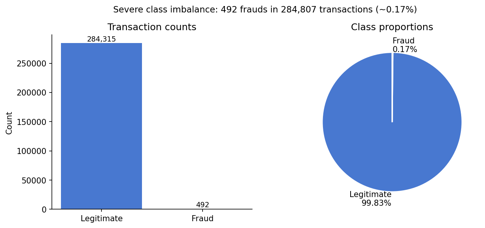
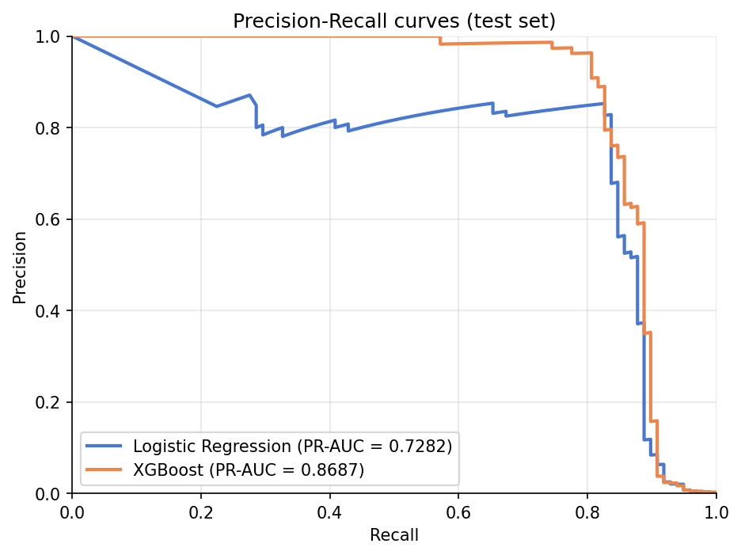
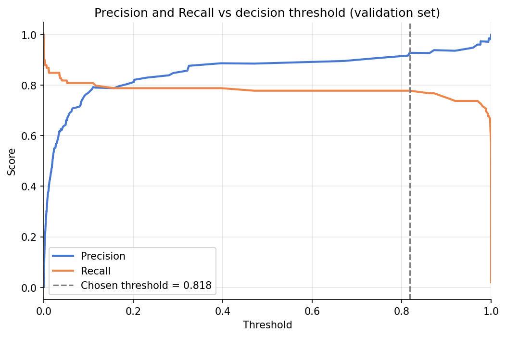
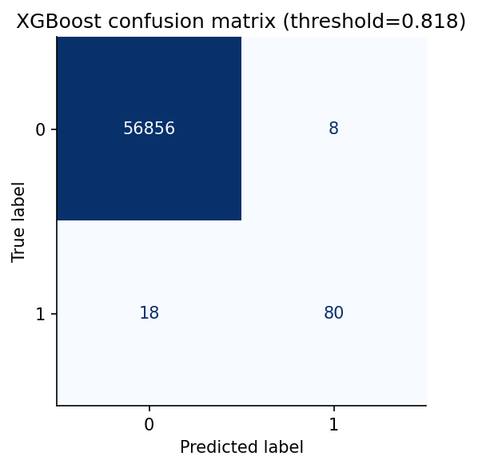

# Credit Card Fraud Detection

A complete fraud-detection pipeline on the classic Kaggle dataset: stratified splits, sklearn Pipelines to prevent leakage, Logistic Regression baseline, Optuna-tuned XGBoost, threshold tuning, and cost-based operating-point selection.

---

## Problem

Given 284,807 anonymised European credit card transactions made over two days (September 2013), identify which 492 are fraudulent (0.17% fraud rate). The severe class imbalance makes accuracy useless — a model that always predicts "not fraud" scores **99.83% accuracy while catching zero fraud**. This project uses PR-AUC as the primary metric and demonstrates the full detection workflow including threshold tuning.

---

## Data

| Property | Value |
|---|---|
| **Source** | [Kaggle — Credit Card Fraud Detection](https://www.kaggle.com/datasets/mlg-ulb/creditcardfraud) |
| **Size** | 284,807 transactions × 31 columns (~144 MB) |
| **Fraud rate** | 492 / 284,807 = **0.1727%** |
| **Features** | `Time`, `Amount`, `V1–V28` (PCA-anonymised), `Class` (0=legit, 1=fraud) |

> **Data is not included in this repo.** See [`data/README.md`](data/README.md) for download instructions. The raw CSV belongs in `data/raw/creditcard.csv`.

---

## Approach

- **Stratified 60/20/20 train/val/test split** (seed=42). Test set is touched once — at the very end.
- **sklearn Pipelines** fit `StandardScaler` only on training data inside each fold, preventing any leakage.
- **Imbalance handling** via `class_weight="balanced"` (Logistic Regression) and `scale_pos_weight` (XGBoost). No synthetic over-sampling applied before splitting.
- **Model selection** via stratified 5-fold CV scored on PR-AUC on the training set.
- **XGBoost tuning** with Optuna (50 trials), optimised on validation PR-AUC with early stopping.
- **Threshold selection** on the validation set only; the chosen threshold is applied unchanged to the test set.
- **Cost-based threshold**: illustrative analysis assuming a missed fraud costs the transaction Amount and a false alarm costs a fixed €10 review fee (configurable in `src/config.py`).

---

## Key Results

### Model comparison (test set, default 0.5 threshold for LR, chosen threshold for XGBoost)

| Model | CV PR-AUC | Test PR-AUC | Test ROC-AUC | Precision | Recall | F1 |
|---|---|---|---|---|---|---|
| DummyClassifier (always "not fraud") | — | — | — | — | 0.0000 | — |
| Logistic Regression (balanced) | 0.7759 ± 0.0738 | 0.7282 | 0.9722 | 0.0625 | 0.9184 | 0.1170 |
| **XGBoost (Optuna-tuned)** | **0.8641 ± 0.0760** | **0.8687** | **0.9743** | **0.9091** | **0.8163** | **0.8602** |

> XGBoost uses chosen threshold = **0.8177** (max F1 on validation set). Logistic Regression uses default 0.5.

### Threshold operating points (XGBoost, thresholds chosen on validation set)

| Operating point | Threshold | Precision | Recall | F1 | Legit flagged / 1 000 reviewed |
|---|---|---|---|---|---|
| Max F1 *(chosen)* | 0.818 | 0.9091 | 0.8163 | 0.8602 | 91 |
| Precision ≥ 90% | 0.738 | 0.9059 | 0.7778 | 0.8370 | 94 |
| Recall ≥ 90% | 0.000 | 0.0349 | 0.9091 | 0.0673 | 965 |
| Min cost (missed=Amount, review=€10) | 0.969 | 0.9605 | 0.7374 | 0.8343 | 40 |

### Key figures

| | |
|---|---|
|  |  |
|  |  |

---

## How to Run

```bash
# 1. Clone
git clone https://github.com/Maryamali2805/data-science-projects.git
cd data-science-projects/credit-card-fraud-detection
```

```bash
# 2. Create and activate virtual environment
python -m venv .venv
# Windows:
.venv\Scripts\activate
# Mac/Linux:
source .venv/bin/activate
```

```bash
# 3. Install dependencies
pip install -r requirements.txt
```

```bash
# 4. Download data (requires Kaggle API credentials in ~/.kaggle/kaggle.json)
python -m src.download_data
# OR manually place creditcard.csv in data/raw/
```

```bash
# 5. Run the full pipeline (EDA → train → evaluate → threshold → figures)
python -m src.run_all
```

```bash
# 6. Run tests
pytest
```

```bash
# 7. Open the notebook
jupyter notebook notebooks/fraud_detection.ipynb
```

Results JSON saved to `reports/results.json`. Figures saved to `reports/figures/`.

---

## Project Structure

```
credit-card-fraud-detection/
├── data/
│   ├── raw/              # gitignored — place creditcard.csv here
│   └── README.md         # data source and download instructions
├── notebooks/
│   └── fraud_detection.ipynb
├── reports/
│   ├── figures/          # saved PNG figures
│   └── results.json      # all metrics from the last run
├── src/
│   ├── config.py         # paths, seeds, cost parameters
│   ├── data.py           # load + stratified split
│   ├── download_data.py  # Kaggle CLI wrapper
│   ├── evaluate.py       # metric helpers
│   ├── features.py       # sklearn Pipelines
│   ├── plots.py          # figure generation
│   ├── run_all.py        # end-to-end entry point
│   ├── threshold.py      # operating-point analysis
│   └── train.py          # LR baseline + XGBoost + Optuna tuning
├── tests/
│   └── test_pipeline.py  # split integrity, metric sanity, threshold checks
├── conftest.py
├── pytest.ini
└── requirements.txt
```

---

## Limitations & Next Steps

**Limitations**
1. V1–V28 are PCA-transformed and anonymised — feature importance can't be translated to business variables.
2. Only 48 hours of data: no concept-drift testing, no seasonal patterns.
3. Single dataset, one geographic region (European cards).
4. No temporal validation (a stricter split would use day 1 for training, day 2 for testing).
5. Cost assumptions (€10 review fee) are illustrative; real values require input from operations teams.

**Next steps**
- Time-based train/test split to simulate production deployment.
- Online learning / drift detection as fraud patterns evolve.
- SHAP values for deeper feature-level explanation.
- Ensemble or stacking of LR + XGBoost for robustness.
- Hyperparameter tuning with a larger budget (200+ trials).
