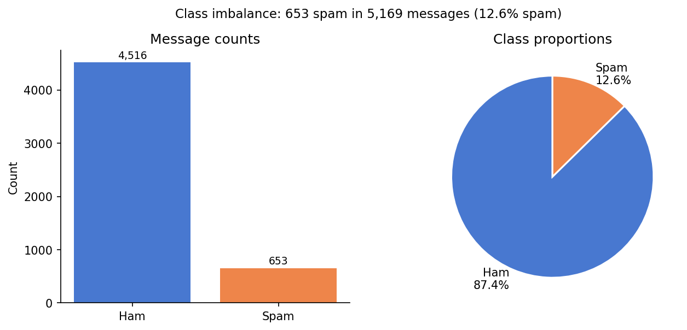
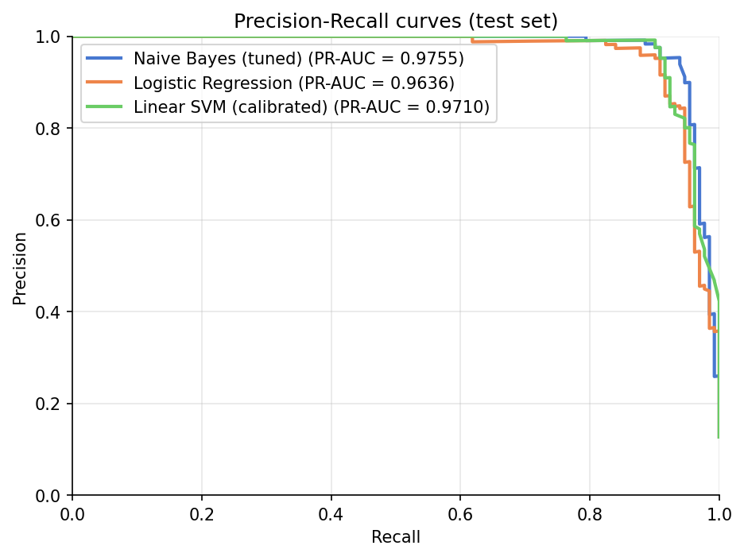
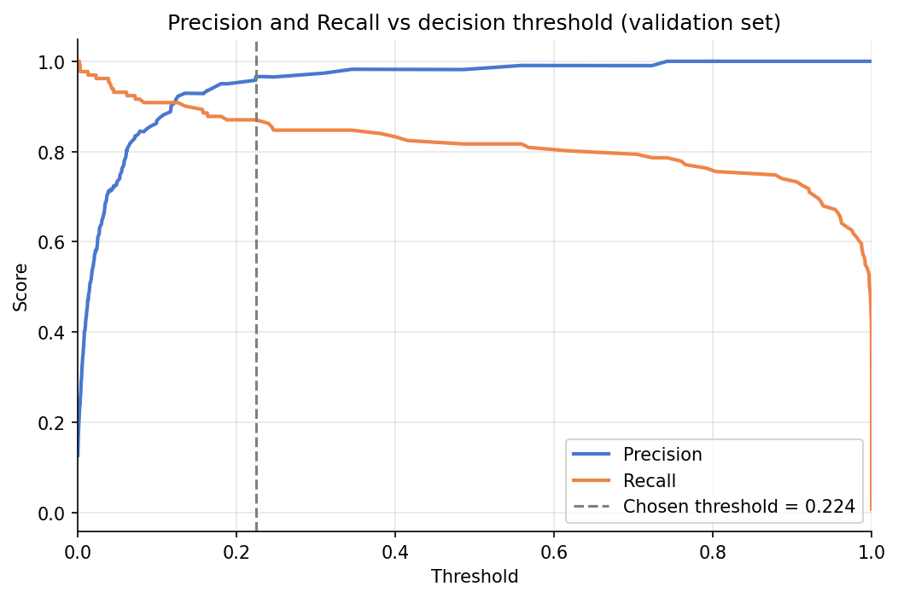
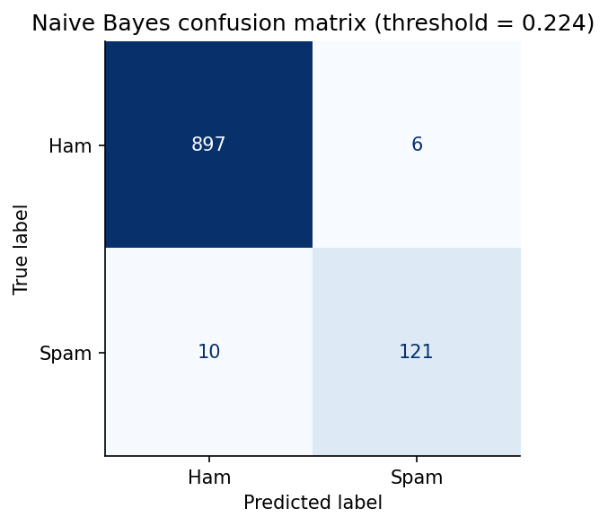

# SMS Spam Detection

A complete spam-classification pipeline on the UCI SMS Spam Collection: text
preprocessing, TF-IDF feature engineering, Naive Bayes (main model) vs Logistic
Regression and Linear SVM (baselines), threshold tuning, error analysis, and an
interactive predict CLI.

---

## Problem

Given 5,572 SMS messages labelled ham or spam (~13% spam), classify each message.
A model that always predicts "ham" scores **87.33% accuracy** while catching
zero spam — the same accuracy paradox as imbalanced tabular data. This project
uses PR-AUC as the primary metric and demonstrates the full text-classification
workflow including preprocessing comparison and threshold tuning.

---

## Data

| Property | Value |
|---|---|
| **Source** | [Kaggle — SMS Spam Collection (UCI)](https://www.kaggle.com/datasets/uciml/sms-spam-collection-dataset) |
| **Raw rows** | 5,572 messages |
| **Duplicates removed** | 403 (before splitting — prevents leakage) |
| **Unique rows used** | 5,169 |
| **Spam rate (after dedup)** | 653 / 5,169 = **12.63%** |
| **Encoding** | latin-1 |
| **Columns** | `v1` (label), `v2` (text), plus three unnamed filler columns (dropped) |

> **Data is not included in this repo.** See [`data/README.md`](data/README.md) for download instructions. The raw CSV belongs in `data/raw/spam.csv`.

---

## Approach

- **Stratified 60/20/20 train/val/test split** (seed=42). Duplicates removed **before** splitting so no identical message can appear in both train and test.
- **sklearn Pipelines** fit the TF-IDF vectoriser only on training data inside each cross-validation fold — no vocabulary leakage.
- **Preprocessing comparison**: minimal cleaning (lowercase only) vs heavy cleaning (digit normalisation + punctuation stripping + stopword removal + Porter stemming). Grid search showed minimal cleaning wins: TF-IDF's IDF weighting already acts as a soft stopword filter, and stemming can merge discriminative spam tokens.
- **Feature search**: grid over `{minimal, heavy}` × `{(1,1), (1,2)}` ngrams × `{10k, 30k, None}` features × `{0.01, 0.1, 1.0}` NB alpha (5-fold CV PR-AUC).
- **NB cost asymmetry**: in spam filtering, a false positive (real message sent to spam) is usually worse than a false negative (spam gets through), so high precision is prioritised.
- **Threshold selection** on the validation set only; the chosen threshold is applied unchanged to the test set.

---

## Key Results

### Model comparison (test set, default 0.5 threshold for LR and SVM, chosen threshold for NB)

| Model | CV PR-AUC | Test PR-AUC | Precision | Recall | F1 |
|---|---|---|---|---|---|
| DummyClassifier (always ham) | — | — | — | 0.0000 | — |
| Logistic Regression | 0.9739 ± 0.0040 | 0.9636 | 0.9516 | 0.9008 | 0.9255 |
| Linear SVM (calibrated) | 0.9780 ± 0.0046 | 0.9710 | 0.9520 | 0.9084 | 0.9297 |
| **Naive Bayes (tuned)** | **0.9714 ± 0.0113** | **0.9755** | **0.9528** | **0.9237** | **0.9380** |

> NB best params: `cleaning=minimal`, `ngram=(1,2)`, `max_features=10000`, `alpha=0.1`.  
> NB uses chosen threshold = **0.2243** (max F1 on validation set). LR and SVM use default 0.5.

### Threshold operating points (NB, thresholds chosen on validation set, applied to test)

| Operating point | Threshold | Precision | Recall | F1 |
|---|---|---|---|---|
| Max F1 *(chosen)* | 0.224 | 0.9528 | 0.9237 | 0.9380 |
| Precision ≥ 99% | 0.559 | 0.9831 | 0.8855 | 0.9317 |
| Recall ≥ 95% | 0.040 | 0.7412 | 0.9618 | 0.8372 |

### Key figures

| | |
|---|---|
|  |  |
|  |  |

### Example predictions

| Message | Label | Spam probability |
|---|---|---|
| Congratulations! You have been selected to claim a FREE prize. Call NOW! | **SPAM** | 0.9994 |
| Hey, are you free for lunch tomorrow around 1pm? | **HAM** | 0.0005 |

---

## How to Run

```bash
# 1. Clone
git clone https://github.com/Maryamali2805/data-science-projects.git
cd data-science-projects/sms-spam-detection
```

```bash
# 2. Create and activate virtual environment
python -m venv .venv
# Windows:
.venv\Scripts\activate
# Mac/Linux:
source .venv/bin/activate
```

```bash
# 3. Install dependencies
pip install -r requirements.txt
```

```bash
# 4. Download data (requires Kaggle API credentials in ~/.kaggle/kaggle.json)
python -m src.download_data
# OR manually place spam.csv in data/raw/
```

```bash
# 5. Run the full pipeline (EDA → train → evaluate → threshold → figures)
python -m src.run_all
```

```bash
# 6. Run tests
pytest
```

```bash
# 7. Predict a message
python -m src.predict "Win a FREE iPhone now! Call 08001234567"
```

```bash
# 8. Open the notebook
jupyter notebook notebooks/spam_detection.ipynb
```

Results JSON saved to `reports/results.json`. Figures saved to `reports/figures/`.

---

## Project Structure

```
sms-spam-detection/
├── data/
│   ├── raw/              # gitignored — place spam.csv here
│   └── README.md         # data source and download instructions
├── notebooks/
│   └── spam_detection.ipynb
├── reports/
│   ├── figures/          # saved PNG figures
│   └── results.json      # all metrics from the last run
├── src/
│   ├── config.py         # paths, seeds, constants
│   ├── data.py           # load, dedupe, stratified split
│   ├── download_data.py  # Kaggle CLI wrapper
│   ├── evaluate.py       # metric helpers
│   ├── features.py       # sklearn Pipelines (NB, LR, SVM)
│   ├── plots.py          # figure generation
│   ├── predict.py        # CLI prediction
│   ├── preprocess.py     # minimal and heavy text cleaners
│   ├── run_all.py        # end-to-end entry point
│   ├── threshold.py      # operating-point analysis
│   └── train.py          # grid-search tuning + model training
├── tests/
│   └── test_pipeline.py  # 19 tests
├── conftest.py
├── pytest.ini
└── requirements.txt
```

---

## Limitations & Next Steps

**Limitations**
1. Small dataset (~5k messages) from early 2000s UK/Singapore mobile SMS — modern spam patterns differ significantly.
2. English-only; SMS dialect varies by region.
3. Many spam messages are near-duplicates from the same campaign; the 403 removed duplicates may mask true generalisation performance.
4. No temporal validation — messages from the same sender could appear in both train and test.
5. `lt` / `gt` tokens (XML encoding artefacts) rank as top ham signals, suggesting dataset encoding issues that a production pipeline would need to handle.

**Next steps**
- Add character-level n-grams (spammers often obfuscate: "F.R.E.E", "fr3e").
- Extend with neural bag-of-words or fine-tuned sentence transformers.
- Apply to multilingual SMS datasets.
- Add online learning to adapt to new spam vocabulary over time.
